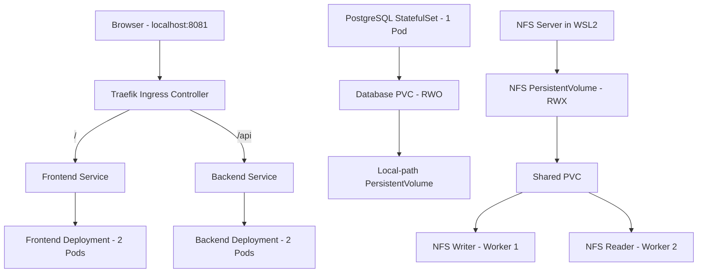

# TaskHub — Kubernetes Infrastructure Project

## 1. Project Overview

TaskHub is a production-like Kubernetes infrastructure lab built
on a local three-node kind cluster.

The purpose of this project is to demonstrate how a DevOps engineer
can deploy, expose, configure, secure, and troubleshoot applications
using Kubernetes.

The environment includes:
- 1 Kubernetes control-plane node
- 2 Kubernetes worker nodes
- A dedicated namespace named `taskhub`
- Frontend and backend Deployments
- A PostgreSQL StatefulSet with persistent storage
- Kubernetes Services and Traefik Ingress
- ConfigMaps and Secrets
- DaemonSets, Jobs, and CronJobs
- RBAC permissions using least privilege
- Health probes, resource limits, and recovery testing

This is an infrastructure demonstration, not a complete TaskHub
application. The frontend uses NGINX, and the backend uses a
simple HTTP echo container.

## 2. Architecture



The PostgreSQL database is demonstrated separately from the
HTTP echo backend. A working backend-to-database application
connection is outside the scope of this infrastructure lab.

## 3. Project Environment

| Component | Technology |
|---|---|
| Host environment | Windows + WSL2 Ubuntu |
| Container runtime | Docker |
| Kubernetes distribution | kind |
| Kubernetes version | v1.37.0 |
| Cluster | taskhub |
| Nodes | 1 control-plane + 2 workers |
| Application namespace | taskhub |
| Ingress controller | Traefik |
| Database | PostgreSQL 16 |
| Package manager | Helm 4 |

## 4. Access URLs

| URL | Purpose |
|---|---|
| http://localhost:8080 | Frontend through NodePort |
| http://localhost:8081/ | Frontend through Traefik |
| http://localhost:8081/api | Backend through Traefik |

## 5. Kubernetes Workloads

### Namespace and Labels

All main application workloads run in the `taskhub` namespace.

Consistent labels such as `app`, `component`, and `environment`
allow resources to be identified and selected.

### Frontend Deployment

The frontend uses `nginx:stable-alpine` with two replicas.

A Deployment manages a ReplicaSet, which maintains the desired
number of frontend Pods.

The frontend includes:
- CPU and memory requests and limits
- Startup, readiness, and liveness probes
- ConfigMap-based environment variables
- A ClusterIP Service

### Backend Deployment

The backend uses `hashicorp/http-echo:1.0.0` with two replicas.

It returns the fixed message "TaskHub Backend API".

The backend includes:
- CPU and memory requests and limits
- Startup, readiness, and liveness probes
- ConfigMap and Secret references
- A ClusterIP Service on port 5678

### Database StatefulSet

PostgreSQL 16 runs as a single-replica StatefulSet.

The StatefulSet provides a stable Pod identity, `taskhub-db-0`.
A headless Service supports its stable network identity.

Database files are stored using a PersistentVolumeClaim.

### DaemonSet

The `taskhub-node-agent` DaemonSet runs one simulated node-agent
Pod on each of the two worker nodes.

Each agent prints its node name to the logs every 30 seconds.

Node affinity restricts the agents to the worker nodes.

## 6. Kubernetes Storage

### emptyDir

An `emptyDir` volume provides temporary Pod-associated storage.

We created `emptydir-demo`, wrote a test file, then deleted
and recreated the Pod.

Result: The original file disappeared.

### hostPath

A `hostPath` volume mounts a directory from a node filesystem
directly into a Pod.

We created `hostpath-demo` on `taskhub-worker`, wrote a file,
then recreated the Pod on the same worker.

Result: The original file survived.

Limitation: This data is tied to the worker's filesystem
and is not automatically shared across nodes.

### PersistentVolumes and PersistentVolumeClaims

A PersistentVolume (PV) represents storage in the cluster.

A PersistentVolumeClaim (PVC) requests storage for a workload.

Our PostgreSQL database uses:
- PVC: `taskhub-db-pvc`
- StorageClass: `standard`
- Capacity: 1Gi
- Access mode: ReadWriteOnce (RWO)
- Provisioner: local-path

The underlying storage is local to `taskhub-worker`.

We deleted and recreated the PostgreSQL Pod and verified
that its original database record survived.

### NFS Shared Storage

We configured an NFS server in WSL2 and exported:

`/srv/taskhub-nfs`

The Kubernetes resources are:
- PV: `taskhub-nfs-pv`
- PVC: `taskhub-nfs-pvc`
- Access mode: ReadWriteMany (RWX)

Two test Pods use this shared PVC:
- `nfs-writer` on `taskhub-worker`
- `nfs-reader` on `taskhub-worker2`

We wrote a file from the first Pod and successfully read
the same file from the second Pod.

This verifies shared file access across two Kubernetes workers.

The NFS PV advertises 1Gi capacity, but this does not
enforce a physical quota on the exported directory.

The NFS setup depends on the external WSL2 server and
its reachable IP address. It must be configured separately
when recreating the lab.

## 7. Kubernetes Networking

### ClusterIP Services

ClusterIP Services expose applications inside the Kubernetes
cluster using stable virtual addresses.

TaskHub uses:
- `taskhub-frontend` on port 80
- `taskhub-backend` on port 5678

The Services select application Pods using labels and route
traffic to available endpoints.

### NodePort Service

The frontend NodePort Service uses port 30080.

The kind cluster maps localhost:8080 to this NodePort,
allowing the frontend to be accessed from the host computer.

### LoadBalancer Service

We created a frontend LoadBalancer Service to demonstrate
the Kubernetes LoadBalancer Service type.

Its external IP remains pending because our local kind
environment does not have an external load balancer.

The Service can still be accessed internally.

### Ingress and Traefik

Traefik was installed using Helm as our Ingress controller.

Traefik receives HTTP requests through NodePort 30081,
which kind maps to localhost:8081.

The TaskHub Ingress defines two routes:

- `/` forwards requests to `taskhub-frontend:80`
- `/api` forwards requests to `taskhub-backend:5678`

Both routes were tested successfully and returned HTTP 200.

Ingress provides routing rules, while Traefik is the
controller that implements those rules.

### Headless Service

The PostgreSQL StatefulSet uses `taskhub-db-headless`.

This Service supports the stable network identity of
the database Pod rather than providing a normal ClusterIP.

## 8. Configuration and RBAC Security

### ConfigMap

The `taskhub-config` ConfigMap stores non-sensitive
application settings:

- APP_NAME
- APP_ENV
- LOG_LEVEL

The frontend and backend reference this ConfigMap.

### Secret

The `taskhub-secret` Secret contains lab-only
database credentials.

The backend references the Secret, and PostgreSQL uses
it to configure the database account.

The local Secret manifest is excluded from Git using:

`/config/secret.yaml`

Real credentials should never be committed to Git.

### ServiceAccount

We created a dedicated ServiceAccount:

`taskhub-pod-reader`

It represents a workload identity within the
`taskhub` namespace.

### Role

The Role `taskhub-pod-reader-role` grants:
- get Pods
- list Pods
- watch Pods

It does not grant permission to delete Pods or read Secrets.

### RoleBinding

The RoleBinding `taskhub-pod-reader-binding`
assigns the Role to the ServiceAccount.

### Least Privilege

We tested the ServiceAccount using `kubectl auth can-i`.

Verified results:

| Permission | Result |
|---|---|
| List Pods in taskhub | Allowed |
| Delete Pods in taskhub | Denied |
| Read Secrets in taskhub | Denied |
| Read Pod logs in taskhub | Denied |
| List Pods in default namespace | Denied |

These checks demonstrate that the ServiceAccount only
receives the permissions needed for Pod inspection.

## 9. Kubernetes Jobs and CronJobs

### Single-Completion Job

The `taskhub-job-single` Job demonstrates a one-time task.

Configuration:
- completions: 1
- parallelism: 1
- backoffLimit: 2

Result: The Job completed successfully with 1/1 completions.

### Parallel Job with One Required Success

The `taskhub-job-parallel-one` Job demonstrates
work-queue-style parallel execution.

Configuration:
- parallelism: 3
- completions: unspecified

Kubernetes started three worker Pods concurrently.

One successful completion was sufficient for the success
condition, but the already-running Pods were allowed to finish.

Result: All three Pods completed successfully.
The Job reported 3/1 of 3 completions.

This is a simulated workload without an actual work queue.

### Multiple-Completion Job

The `taskhub-job-multiple` Job demonstrates multiple
successful executions with limited concurrency.

Configuration:
- completions: 6
- parallelism: 2

Kubernetes executed the tasks in multiple rounds,
normally running up to two Pods concurrently.

Result: The Job completed with 6/6 successful executions.

### Scheduled Maintenance CronJob

The `taskhub-maintenance` CronJob runs a simulated
maintenance task every two minutes.

Schedule: `*/2 * * * *`

Configuration:
- concurrencyPolicy: Forbid
- successfulJobsHistoryLimit: 2
- failedJobsHistoryLimit: 1

The CronJob automatically created Jobs, which created
Pods to execute the maintenance commands.

We verified multiple successful scheduled executions
using Job status and container logs.

After testing, the CronJob was suspended to prevent
unnecessary repeated executions.

## 10. Health Probes and Resource Management

### Startup Probe

The startup probe checks whether an application has
finished starting.

It protects applications from premature liveness
and readiness checks during startup.

### Readiness Probe

The readiness probe checks whether an application
is ready to receive traffic.

When readiness fails, Kubernetes marks the Pod
NotReady and removes it from normal Service traffic.

Readiness failure does not itself restart the container.

### Liveness Probe

The liveness probe checks whether the application
is still functioning correctly.

Repeated liveness failures cause Kubernetes to
restart the affected container.

### Probe Implementation

The frontend and backend use HTTP probes.

The frontend checks the NGINX endpoint `/`.
The backend checks the HTTP echo endpoint `/`.

PostgreSQL uses exec probes running `pg_isready`
to check database availability.

### CPU and Memory Requests

Requests are used by the Kubernetes scheduler
to determine whether a node has sufficient resources
to accommodate a Pod.

### CPU and Memory Limits

Limits restrict resource consumption.

CPU usage above the configured limit is throttled.

Exceeding a memory limit can result in the container
being terminated with an OOMKilled condition.

### Resource Configuration

| Application | CPU Request | CPU Limit | Memory Request | Memory Limit |
|---|---|---|---|---|
| Frontend | 25m | 200m | 32Mi | 128Mi |
| Backend | 25m | 200m | 16Mi | 64Mi |
| PostgreSQL | 50m | 500m | 128Mi | 384Mi |

These values were verified using the live Kubernetes
Deployment and StatefulSet configurations.

## 11. Failure Recovery and Troubleshooting

### Test 1: Deployment Self-Healing

Objective:
Verify that Kubernetes maintains the desired number of
frontend replicas after a Pod is deleted.

Procedure:
1. Confirmed that the frontend Deployment had two healthy Pods.
2. Deleted one frontend Pod manually.
3. Observed the ReplicaSet creating a replacement Pod.
4. Verified that the frontend returned to 2/2 ready replicas.

Result: PASSED.

This demonstrates how the Deployment and ReplicaSet controllers
maintain the desired application state.

Deleting a Pod does not delete the Deployment.

### Test 2: Readiness Probe Failure and Rollback

Objective:
Observe how Kubernetes responds when an application
fails its readiness check.

Procedure:
1. Started with two healthy frontend replicas.
2. Changed the frontend readiness probe to an invalid HTTP path.
3. Observed a new frontend ReplicaSet and an unready Pod.
4. The affected Pod was Running but reported 0/1 Ready.
5. Used `kubectl rollout undo` to restore the previous revision.
6. Verified that the frontend returned to 2/2 ready replicas.
7. Confirmed that the frontend and backend HTTP routes
   continued returning HTTP 200.

Result: PASSED.

Important observations:
- Running does not necessarily mean Ready.
- Failed readiness checks prevent an unready Pod from
  receiving normal Service traffic.
- A readiness failure alone does not restart the container.
- Deployment rollback can restore a previously working
  configuration.

### Test 3: PostgreSQL Data Persistence

Objective:
Verify that database records survive PostgreSQL Pod
replacement.

Procedure:
1. Created a test table named `persistence_test`.
2. Inserted a record containing:
   "Data survives Pod replacement"
3. Deleted the PostgreSQL Pod.
4. Allowed the StatefulSet to recreate `taskhub-db-0`.
5. Queried the database again without reinserting the record.
6. Confirmed that the original record was still present.
7. Repeated the Pod replacement test successfully.

Result: PASSED.

The StatefulSet reused the existing PersistentVolumeClaim,
allowing PostgreSQL to access its original data.

Limitation:
This proves persistence across Pod replacement while the
underlying volume remains available.

It does not prove recovery from storage loss or failure
of the worker node hosting the local-path volume.

### Additional Validation

The following checks were also completed:

- All three kind nodes reported Ready.
- Frontend and backend Deployments reported 2/2 Ready.
- PostgreSQL StatefulSet reported 1/1 Ready.
- DaemonSet agents ran on both worker nodes.
- Both application Ingress routes returned HTTP 200.
- Database and NFS PersistentVolumeClaims were Bound.
- All three Job examples completed successfully.
- The CronJob created scheduled Jobs successfully.
- RBAC tests confirmed allowed and denied permissions.

### Troubleshooting Lessons

1. Check Pod readiness as well as running status.
2. Use `kubectl describe` to inspect events, probes,
   resource requests, and limits.
3. Use `kubectl logs` to investigate application behavior.
4. Use `kubectl rollout status` to monitor a Deployment.
5. Use `kubectl rollout undo` to revert a failed revision.
6. Verify both PVC binding and underlying storage availability
   when investigating persistent data.
7. Test an application through its actual Service or Ingress
   rather than relying only on Pod status.

## 12. Installation and Reproduction Guide

This section explains how to recreate the TaskHub Kubernetes
infrastructure from the saved project files.

The commands below are intended for a fresh environment.
Do not recreate the cluster when working with an existing
TaskHub installation that contains data you want to preserve.

### Prerequisites

The environment requires:

- Linux or WSL2 Ubuntu
- Docker
- kind
- kubectl
- Helm
- NFS server support for the shared-storage demonstration

Docker must be running before creating the kind cluster.

### Step 1: Create the Kubernetes Cluster

From the project root directory:

```bash
kind create cluster --name taskhub --config kind-config.yaml
```

The kind configuration defines:
- One control-plane node
- Two worker nodes
- Host port 8080 mapped to node port 30080
- Host port 8081 mapped to node port 30081

The configuration requests Kubernetes node image
`kindest/node:v1.37.0`.

Verify cluster creation:

```bash
kubectl get nodes -o wide
```

Expected result: Three nodes reporting Ready.

### Step 2: Create the Application Namespace

Apply the namespace manifest:

```bash
kubectl apply -f namespace/namespace.yaml
```

Verify:

```bash
kubectl get namespace taskhub --show-labels
```

The namespace should have the labels:
- app=taskhub
- environment=lab

### Important Reproduction Notes

The Kubernetes manifests alone do not reproduce every
external dependency.

Additional setup is required for:
- The Traefik Ingress controller
- The WSL2 NFS server and its export configuration
- Kubernetes database credentials
- Any database records that must be restored

The database PVC creates or binds storage but does not
automatically restore records from a deleted volume.

### Step 3: Configure Application Settings

Create the ConfigMap first:

```bash
kubectl apply -f config/configmap.yaml
```

The ConfigMap contains non-sensitive settings used by
the frontend and backend Deployments.

Next, prepare the database Secret.

The file `config/secret.yaml` is deliberately excluded
from Git and must be created locally before deployment.

For example, create a Secret manifest with this structure:

```yaml
apiVersion: v1
kind: Secret
metadata:
  name: taskhub-secret
  namespace: taskhub
type: Opaque
stringData:
  DATABASE_USERNAME: "replace_with_lab_username"
  DATABASE_PASSWORD: "replace_with_lab_password"
```

Save it as `config/secret.yaml`, replacing the example
values with appropriate local credentials.

Apply the Secret:

```bash
kubectl apply -f config/secret.yaml
```

Never commit real credentials to the repository.

### Step 4: Deploy PostgreSQL

Create the database storage claim:

```bash
kubectl apply -f database/pvc.yaml
```

Create the headless Service:

```bash
kubectl apply -f database/headless-service.yaml
```

Deploy the PostgreSQL StatefulSet:

```bash
kubectl apply -f database/statefulset.yaml
```

Verify:

```bash
kubectl get statefulset,pvc -n taskhub
```

Expected:
- `taskhub-db` reports 1/1 Ready
- `taskhub-db-pvc` reports Bound

The database requires an available default StorageClass
compatible with its PVC. The original lab used kind's
standard local-path storage provisioner.

### Step 5: Deploy Frontend and Backend

Deploy the frontend:

```bash
kubectl apply -f frontend/deployment.yaml
kubectl apply -f frontend/service.yaml
```

Deploy the backend:

```bash
kubectl apply -f backend/deployment.yaml
kubectl apply -f backend/service.yaml
```

Verify:

```bash
kubectl get deployments,services -n taskhub
```

Expected:
- Frontend Deployment: 2/2 Ready
- Backend Deployment: 2/2 Ready

The frontend runs NGINX.

The backend runs an HTTP echo container, returning
the message "TaskHub Backend API".

### Step 6: Install Traefik Ingress Controller

Traefik is installed through Helm.

Add the official Traefik Helm repository:

```bash
helm repo add traefik https://traefik.github.io/charts
helm repo update
```

Install the Traefik chart with the saved configuration:

```bash
helm upgrade --install traefik traefik/traefik \
  --namespace traefik \
  --create-namespace \
  --version 41.7.1 \
  -f networking/traefik-values.yaml
```

The values file configures Traefik as a NodePort Service,
with HTTP exposed on NodePort 30081.

The kind cluster maps localhost:8081 to port 30081.

Verify the installation:

```bash
kubectl get pods,services -n traefik
kubectl get ingressclass
```

Expected:
- Traefik Pod is Ready
- Traefik Service is NodePort
- An IngressClass named traefik exists

### Step 7: Configure Application Networking

Create the frontend NodePort Service:

```bash
kubectl apply -f networking/nodeport.yaml
```

Create the frontend LoadBalancer Service:

```bash
kubectl apply -f networking/loadbalancer.yaml
```

Create the TaskHub Ingress:

```bash
kubectl apply -f networking/ingress.yaml
```

Verify:

```bash
kubectl get services,ingresses -n taskhub
```

The local kind environment has no external load
balancer, so the LoadBalancer Service may show
EXTERNAL-IP as pending.

This is expected for our local demonstration.

### Step 8: Test Application Access

Test the frontend through NodePort:

```bash
curl -i http://127.0.0.1:8080/
```

Test the frontend through Traefik:

```bash
curl -i http://127.0.0.1:8081/
```

Test the backend through Traefik:

```bash
curl -i http://127.0.0.1:8081/api
```

Expected:
- Frontend routes return HTTP 200
- Backend route returns HTTP 200
- Backend response includes "TaskHub Backend API"

The application Ingress does not require an
EXTERNAL-IP on the separate LoadBalancer Service.

### Step 9: Deploy the DaemonSet

Apply the simulated node monitoring agent:

```bash
kubectl apply -f daemonset/node-agent.yaml
```

Verify the DaemonSet:

```bash
kubectl get daemonset taskhub-node-agent -n taskhub
```

Expected result: 2 desired and 2 ready Pods.

The DaemonSet uses node affinity to run one agent
on each worker node.

Check the running agents:

```bash
kubectl get pods -n taskhub -o wide
```

The node-agent Pods should be distributed across
taskhub-worker and taskhub-worker2.

### Step 10: Run Kubernetes Jobs

Create the single-completion Job:

```bash
kubectl apply -f jobs/single-job.yaml
```

Create the parallel Job:

```bash
kubectl apply -f jobs/parallel-one-job.yaml
```

Create the multiple-completion Job:

```bash
kubectl apply -f jobs/multiple-job.yaml
```

Check their completion status:

```bash
kubectl get jobs -n taskhub
```

Expected:
- taskhub-job-single: Complete
- taskhub-job-parallel-one: Complete
- taskhub-job-multiple: Complete

These demonstrate different combinations of
parallelism and required successful completions.

### Step 11: Deploy the CronJob

Create the scheduled maintenance task:

```bash
kubectl apply -f cronjobs/maintenance.yaml
```

Check the CronJob:

```bash
kubectl get cronjobs -n taskhub
```

The schedule runs every two minutes.

After a scheduled execution, inspect its Jobs:

```bash
kubectl get jobs -n taskhub
```

The CronJob creates Jobs, and the Jobs create Pods
to perform the scheduled tasks.

Forbid concurrency prevents overlapping executions
of Jobs created by the same CronJob.

After verifying successful scheduled executions,
the CronJob can be suspended:

```bash
kubectl patch cronjob taskhub-maintenance \
  -n taskhub \
  --type merge \
  -p '{"spec":{"suspend":true}}'
```

Suspending prevents new scheduled Jobs but does not
delete Jobs that have already been created.

### Step 12: Configure Kubernetes RBAC

TaskHub uses namespace-scoped Role-Based Access Control
(RBAC) to demonstrate least-privilege permissions.

Create the dedicated ServiceAccount:

```bash
kubectl apply -f rbac/serviceaccount.yaml
```

Create the Role that grants permission to get,
list, and watch Pods:

```bash
kubectl apply -f rbac/role.yaml
```

Create the RoleBinding connecting the ServiceAccount
to the Role:

```bash
kubectl apply -f rbac/rolebinding.yaml
```

Verify that all three resources exist:

```bash
kubectl get serviceaccounts,roles,rolebindings -n taskhub
```

### Test RBAC Permissions

Check an allowed operation:

```bash
kubectl auth can-i list pods \
  --as=system:serviceaccount:taskhub:taskhub-pod-reader \
  -n taskhub
```

Expected result: yes

Check a denied operation:

```bash
kubectl auth can-i delete pods \
  --as=system:serviceaccount:taskhub:taskhub-pod-reader \
  -n taskhub
```

Expected result: no

Check whether the account can read Secrets:

```bash
kubectl auth can-i get secrets \
  --as=system:serviceaccount:taskhub:taskhub-pod-reader \
  -n taskhub
```

Expected result: no

These checks verify the permissions of the dedicated
ServiceAccount, not those of the administrator running
the commands.

The Role is limited to the taskhub namespace.
The ServiceAccount does not receive cluster-wide
administrator permissions.

### Step 13: Configure NFS Shared Storage

TaskHub demonstrates ReadWriteMany storage using an NFS
server installed on the WSL2 Ubuntu host.

The original lab used:
- NFS server address: 192.168.244.55
- Exported directory: /srv/taskhub-nfs
- NFS client nodes: taskhub-worker and taskhub-worker2
- Client addresses at the time: 172.19.0.3 and 172.19.0.4

These IP addresses belong to the original lab environment.
They may change when WSL2 or kind is restarted or recreated.

#### Install and Prepare the NFS Server

On the WSL2 Ubuntu host:

```bash
sudo apt update
sudo apt install -y nfs-kernel-server
sudo mkdir -p /srv/taskhub-nfs
sudo chown 65534:65534 /srv/taskhub-nfs
sudo chmod 0770 /srv/taskhub-nfs
```

The directory is owned by the anonymous NFS user/group,
allowing our demonstration Pods to write shared files.

#### Configure NFS Exports

Create the export configuration file:

`/etc/exports.d/taskhub.exports`

In the original lab, the two worker-node addresses were
authorized to access the shared directory.

An equivalent configuration would be:

```text
/srv/taskhub-nfs 172.19.0.3(rw,sync,no_subtree_check,root_squash) 172.19.0.4(rw,sync,no_subtree_check,root_squash)
```

Replace the example IP addresses with the actual worker
addresses in the recreated environment.

The important export settings are:
- rw: allow reading and writing
- sync: use synchronous write behavior
- no_subtree_check: disable subtree checking
- root_squash: map remote root access to an anonymous user

Apply the export configuration:

```bash
sudo exportfs -ra
sudo systemctl restart nfs-kernel-server
sudo exportfs -v
```

The NFS server must be reachable from both kind workers.

#### Configure the Kubernetes NFS Volume

The file `storage/nfs-pv-pvc.yaml` contains the NFS
PersistentVolume and PersistentVolumeClaim.

Before applying the file on a new environment, update
the PV's `spec.nfs.server` value to the actual reachable
NFS server address.

Apply the storage configuration:

```bash
kubectl apply -f storage/nfs-pv-pvc.yaml
```

Verify that the PVC is bound:

```bash
kubectl get pv taskhub-nfs-pv
kubectl get pvc taskhub-nfs-pvc -n taskhub
```

The NFS volume provides ReadWriteMany (RWX) access.

#### Verify Shared Storage Across Nodes

Create the demonstration Pods:

```bash
kubectl apply -f storage/nfs-demo-pods.yaml
```

Verify that the Pods are running:

```bash
kubectl get pods nfs-writer nfs-reader -n taskhub -o wide
```

The original experiment placed the writer on one worker
and the reader on the other.

A file created in the shared directory by `nfs-writer`
was successfully read by `nfs-reader`.

This demonstrated that both workers could access the
same NFS-backed data through a shared PVC.

Note: An NFS PV advertising 1Gi does not automatically
enforce a 1Gi filesystem quota.

#### Limitations

The setup depends on:
- A functioning NFS server on WSL2
- Correct NFS export permissions
- Network connectivity between workers and the server
- Updated IP addresses when the environment changes

This is a local lab configuration, not a production
high-availability storage system.

### Step 14: Test emptyDir and hostPath Storage

TaskHub includes separate demonstrations of temporary
Pod storage and node-local storage.

These examples are independent of the PostgreSQL database.

#### Test A: emptyDir Storage

Create the demonstration Pod:

```bash
kubectl apply -f storage/emptydir-demo.yaml
```

Verify that it is running:

```bash
kubectl get pod emptydir-demo -n taskhub
```

Create a test file inside the emptyDir volume:

```bash
kubectl exec -n taskhub emptydir-demo -- \
  sh -c 'echo "temporary data" > /workspace/verification.txt'
```

Delete and recreate the Pod:

```bash
kubectl delete pod emptydir-demo -n taskhub
kubectl apply -f storage/emptydir-demo.yaml
```

Once the replacement Pod is ready, check the file:

```bash
kubectl exec -n taskhub emptydir-demo -- \
  sh -c 'test ! -f /workspace/verification.txt && echo "File not found: expected"'
```

Expected result: The original file is gone.

Explanation:

An emptyDir volume exists for the lifetime of its Pod.
Deleting the Pod removes that volume and its contents.

The storage can survive an individual container restart
within the same Pod, but not Pod deletion and recreation.

#### Test B: hostPath Storage

Create the hostPath demonstration Pod:

```bash
kubectl apply -f storage/hostpath-demo.yaml
```

Verify its node placement:

```bash
kubectl get pod hostpath-demo -n taskhub -o wide
```

The manifest places the Pod on `taskhub-worker`.

The hostPath volume uses the node directory:

`/var/local/taskhub-hostpath-demo`

Create a file through the Pod's mounted directory:

```bash
kubectl exec -n taskhub hostpath-demo -- \
  sh -c 'echo "node-local data" > /node-data/verification.txt'
```

Delete and recreate the Pod:

```bash
kubectl delete pod hostpath-demo -n taskhub
kubectl apply -f storage/hostpath-demo.yaml
```

Once the replacement Pod is ready, check the file:

```bash
kubectl exec -n taskhub hostpath-demo -- \
  cat /node-data/verification.txt
```

Expected result:

`node-local data`

Explanation:

The file survives because it is stored in a directory
on the worker node, not in the Pod's temporary filesystem.

However, hostPath does not automatically share data
between nodes.

If the Pod moves to another worker, that worker may not
have the same files.

#### Comparison

| Volume Type | Survives Pod Replacement | Shared Across Nodes |
|---|---|---|
| emptyDir | No | No |
| hostPath | Yes, on the same node | No |
| NFS | Yes, while storage remains available | Yes |

These tests demonstrate why storage selection depends
on the application's persistence and sharing requirements.

Standalone demonstration Pods must be reapplied after
deletion because they are not managed by a Deployment
or StatefulSet.
